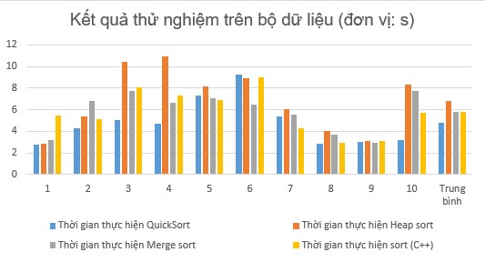

# O-log-n-sort-vs-C-sort

# Báo cáo thử nghiệm các thuật toán sắp xếp

### I. Kết quả thử nghiệm

#### 1. Bảng thời gian thực hiện

| Dữ liệu | QuickSort | Heap sort | Merge sort | sort (C++) |
|---:|---:|---:|---:|---:|
| 1 | 2.808 | 2.894 | 3.152 | 5.483 |
| 2 | 4.304 | 5.399 | 6.800 | 5.124 |
| 3 | 5.051 | 10.401 | 7.734 | 8.113 |
| 4 | 4.748 | 10.948 | 6.664 | 7.318 |
| 5 | 7.302 | 8.170 | 7.091 | 6.924 |
| 6 | 9.269 | 8.886 | 6.508 | 9.011 |
| 7 | 5.419 | 6.070 | 5.571 | 4.277 |
| 8 | 2.853 | 4.047 | 3.734 | 2.980 |
| 9 | 3.049 | 3.147 | 2.966 | 3.105 |
| 10 | 3.169 | 8.342 | 7.731 | 5.740 |
| **Trung bình** | **4.797** | **6.830** | **5.795** | **5.808** |

#### 2. Biểu đồ (cột) thời gian thực hiện

### II. Kết luận

Dựa trên bảng kết quả thử nghiệm thời gian thực hiện (đơn vị: giây) của 4 thuật toán sắp xếp trên 10 bộ dữ liệu khác nhau, có thể rút ra các kết luận sau:

#### 1. Xếp hạng hiệu năng trung bình (từ nhanh nhất đến chậm nhất)

- QuickSort: 4.797s (Nhanh nhất)
- Merge sort: 5.795s
- sort (C++): 5.808s (Gần như tương đương Merge sort)
- Heap sort: 6.830s (Chậm nhất)

#### 2. Phân tích chi tiết từng thuật toán

- **QuickSort:**
  - Có tốc độ trung bình nhanh nhất.
  - Thời gian thực thi rất nhanh ở một số bộ dữ liệu (bộ 1: 2.808s, bộ 8: 2.853s, bộ 9: 3.049s).
  - Tuy nhiên, thuật toán này **kém ổn định**. Thời gian thực hiện dao động rất lớn (từ 2.808s đến 9.269s). Đặc biệt ở bộ dữ liệu số 6, QuickSort mất tới 9.269s, chậm hơn tất cả các thuật toán khác. Điều này cho thấy QuickSort bị ảnh hưởng mạnh bởi đặc điểm của dữ liệu đầu vào (có thể rơi vào trường hợp xấu nhất O(N²) nếu dữ liệu gần như đã sắp xếp hoặc chọn pivot kém).

- **Heap sort:**
  - Có hiệu năng trung bình kém nhất.
  - Thời gian thực hiện thường xuyên ở mức cao, đặc biệt chậm ở các bộ dữ liệu 3 (10.401s), 4 (10.948s) và 10 (8.342s).

- **Merge sort:**
  - Hiệu năng trung bình khá tốt (5.795s).
  - Thời gian thực hiện **ổn định hơn** so với QuickSort và Heap sort. Mức thời gian dao động từ 2.966s đến 7.734s. Không có bộ dữ liệu nào khiến Merge sort bị chậm đột biến như QuickSort (bộ 6) hay Heap sort (bộ 4).

- **sort (C++):**
  - Đây là hàm sắp xếp của C++ (thường là Introsort - kết hợp QuickSort, Heap sort và Insertion sort).
  - Hiệu năng trung bình tương đương với Merge sort (5.808s).
  - Thời gian thực hiện khá ổn định, nhưng bất ngờ là ở bộ dữ liệu 1, hàm này lại chạy chậm nhất (5.483s).

#### 3. Kết luận chung

- **QuickSort** là lựa chọn tốt nhất về mặt tốc độ trung bình, nhưng cần cẩn trọng với các trường hợp dữ liệu đặc biệt (đã sắp xếp hoặc gần sắp xếp) vì có thể suy giảm hiệu năng nghiêm trọng.
- **Merge sort** và **sort (C++)** là những lựa chọn an toàn và ổn định hơn, phù hợp khi cần đảm bảo thời gian chạy không bị đột biến quá lớn.
- **Heap sort** tỏ ra kém hiệu quả nhất về mặt thời gian thực thi trên bộ dữ liệu thử nghiệm này.
- Kết quả thực nghiệm phụ thuộc rất lớn vào kích thước và trạng thái ban đầu của bộ dữ liệu (đã sắp xếp, ngẫu nhiên, hay đảo ngược).
